<div align="center">
  <h1>
    <marquee scrollamount="6" behavior="scroll" direction="left">
      GREETING~
    </marquee>
    <br>
    <marquee scrollamount="4" behavior="scroll" direction="right">
      我是Eason猫哆哩!!!
    </marquee>
  </h1>
</div>

<div align="center">
  
</div>

<div align="center">
  
</div>

---

## 👋 关于我

<div align="center">

🎓 **本科在读大学生**　|　🤖 **AI 全栈开发学习中**　|　🐱 **猫哆哩本哩**

</div>

- 🌱 正在系统学习 **AI 全栈开发**，努力打通「前端 → 后端 → AI → 上线」的完整链路
- 💻 目前的技术栈是 **C / C++ / Qt / Python**，享受用代码从零搭建东西的快乐
- 🧠 关注 AI 应用与大模型落地，也在持续补强工程基础
- ✨ 保持好奇，持续成长，每天进步一点点

## 🛠️ 技术栈

<div align="center">


</div>

## 🚀 我的学习路线

<div align="center">

```text
  🎓 本科在读
      │
      ▼
  💻 C / C++ / Qt / Python 打基础
      │
      ▼
  🌐 前端 + ⚙️ 后端 工程能力
      │
      ▼
  🧠 AI 应用开发 · 大模型 · 智能体
      │
      ▼
  🚀 AI 全栈 · 独立交付完整产品
```

</div>

## 📊 GitHub 数据

<div align="center">


</div>

## 🕹️ 吃豆人小游戏

<div align="center">

<picture>
  <source media="(prefers-color-scheme: dark)" srcset="https://raw.githubusercontent.com/EasonMDR/EasonMDR/output/pacman-contribution-graph-dark.svg">
  <source media="(prefers-color-scheme: light)" srcset="https://raw.githubusercontent.com/EasonMDR/EasonMDR/output/pacman-contribution-graph.svg">
  
</picture>

</div>

## 🌙 写在最后

<div align="center">

> 慢慢来，比较快。　—— 一只正在变强的猫哆哩 🐾


</div>
